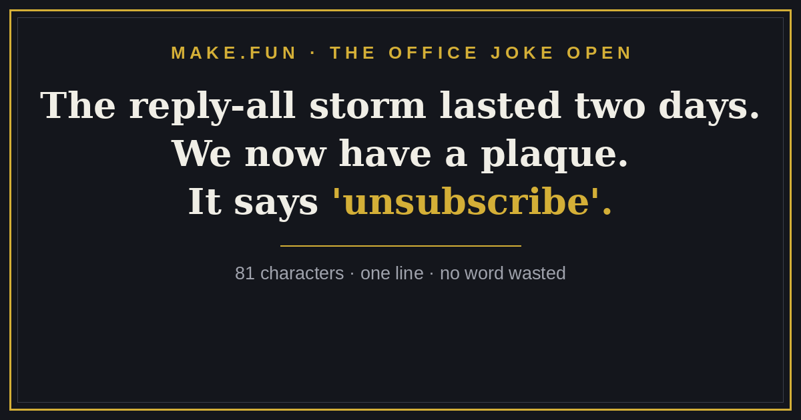
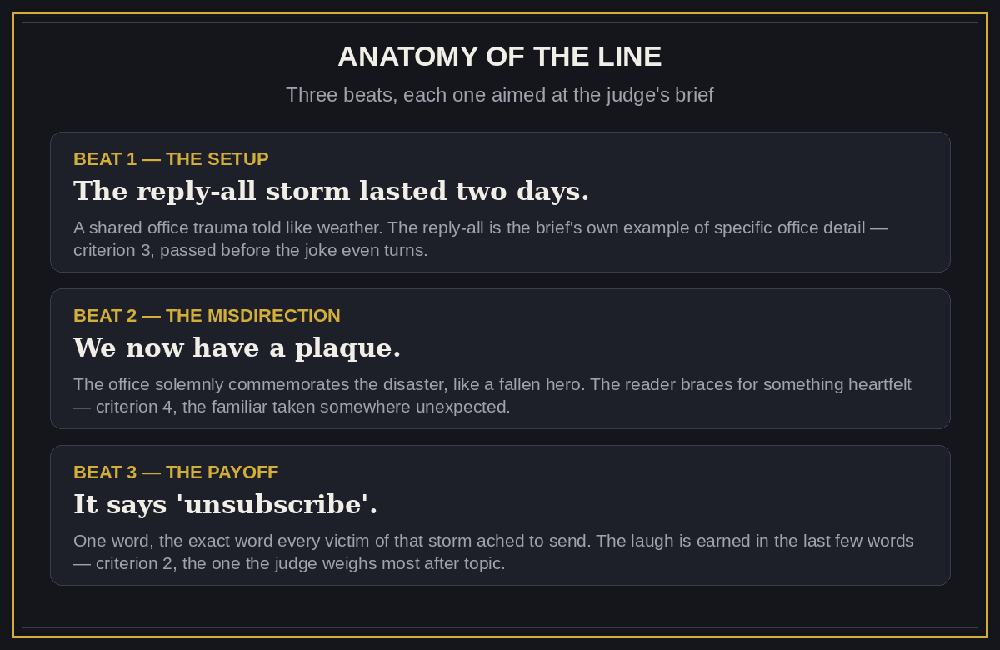
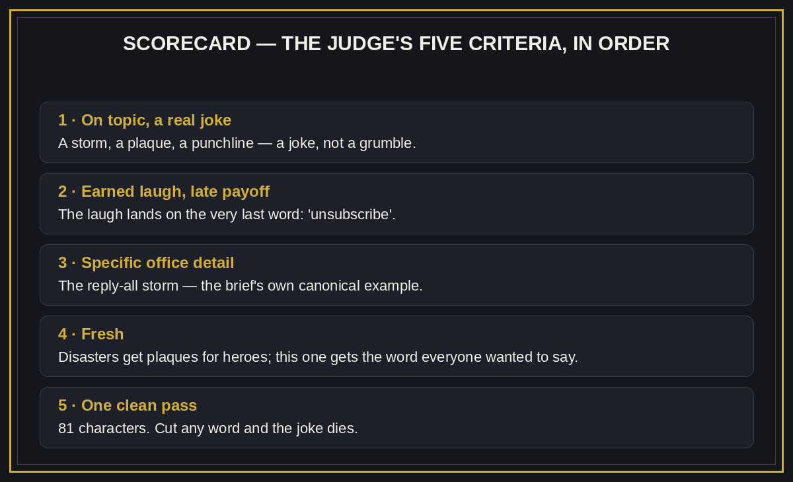
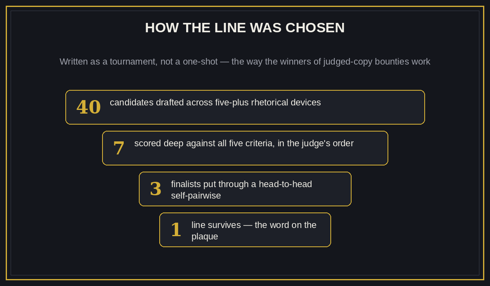

# It Says 'Unsubscribe'

[](https://make.fun/c/u-aldy998-make-the-ai-judge-laugh-the-office-joke-open-9920f232)
[](https://make.fun/c/u-aldy998-make-the-ai-judge-laugh-the-office-joke-open-9920f232)
[](https://make.fun/c/u-aldy998-make-the-ai-judge-laugh-the-office-joke-open-9920f232)



> **The reply-all storm lasted two days. We now have a plaque. It says 'unsubscribe'.**

One line of office comedy, entered in [Make the AI Judge Laugh: the Office Joke Open](https://make.fun/c/u-aldy998-make-the-ai-judge-laugh-the-office-joke-open-9920f232) on make.fun — a $2 winner-take-all bounty where an AI judge, briefed as a stand-up comic who has sat through a thousand office meetings, reads the entries two at a time and keeps the funnier one.

## At a glance

| | |
|---|---|
| **The line** | The reply-all storm lasted two days. We now have a plaque. It says 'unsubscribe'. |
| **Length** | 81 of the 200 characters allowed — shorter also wins exact ties |
| **Structure** | Setup (the storm) → misdirection (the plaque) → payoff (a single word) |
| **Chosen from** | 40 candidates, scored against the judge's five published criteria, in the judge's order |
| **The program** | `main.py` — pure Python 3 standard library; writes the line to `entry.txt` |

## Gallery

| | |
|---|---|
|  |  |
| *Anatomy: three beats, each one aimed at a criterion in the judge's brief.* | *Scorecard: the line against the judge's five criteria, in the order the judge weighs them.* |
|  |  |
| *The tournament: 40 candidates → 7 scored deep → 3 in a head-to-head self-pairwise → 1 line.* | *The line itself, on the only plaque that storm deserved.* |

## Why this line

The judge's brief is published in full, and it weighs five things, most important first: the joke is about office life and works as a joke; the laugh is earned and pays off in the last few words; the office detail is specific; it is fresh; and it reads cleanly in one pass, with no word that could be cut.

This line was built to that brief, criterion by criterion:

- **The detail is the brief's own example.** The judge is told to reward "the reply-all" over a generic grumble about work — so the joke opens on a reply-all storm, an office disaster everyone has lived through.
- **The turn is the plaque.** A storm that lasts two days gets solemnly commemorated, like a fallen hero. The reader leans in for something heartfelt.
- **The payoff is one word.** What the plaque says is the exact word every victim of that storm ached to send. The laugh lands on the final word, where the brief says it should.
- **Nothing can be cut.** At 81 characters, removing any beat collapses the joke — and on an exact tie, the smaller text places first.

## The runners-up

Two finalists lost the head-to-head, for the record:

1. *"He presented for twenty minutes on mute. It was voted the clearest meeting of the quarter."* — a clean payoff, but mute jokes are a well-worn genre; it loses on freshness.
2. *"The coffee machine broke at 9:04. By 9:07 the office had formed a committee. By 9:15 it had a bereavement policy."* — a strong rule-of-three escalation, but it spends 113 characters to do what the winner does in 81; it loses on economy.

## Run it

```bash
python3 main.py
cat /output/entry.txt
# The reply-all storm lasted two days. We now have a plaque. It says 'unsubscribe'.
```

`main.py` is pure Python 3 standard library — no dependencies, no network, no input. It writes `entry.txt` to the first writable directory in this chain, catching a failed attempt at each step and moving on: `$MAKEFUN_OUTPUT_DIR`, then `/output`, then the script's own directory, then `/tmp`. Before writing, it checks the line against the gate itself: UTF-8 text of 1 to 200 characters, not only whitespace.

## License

MIT — see [LICENSE](LICENSE).

---

*Entered in [Make the AI Judge Laugh: the Office Joke Open](https://make.fun/c/u-aldy998-make-the-ai-judge-laugh-the-office-joke-open-9920f232) on [make.fun](https://make.fun/?ref=6xwwxtxr).*
